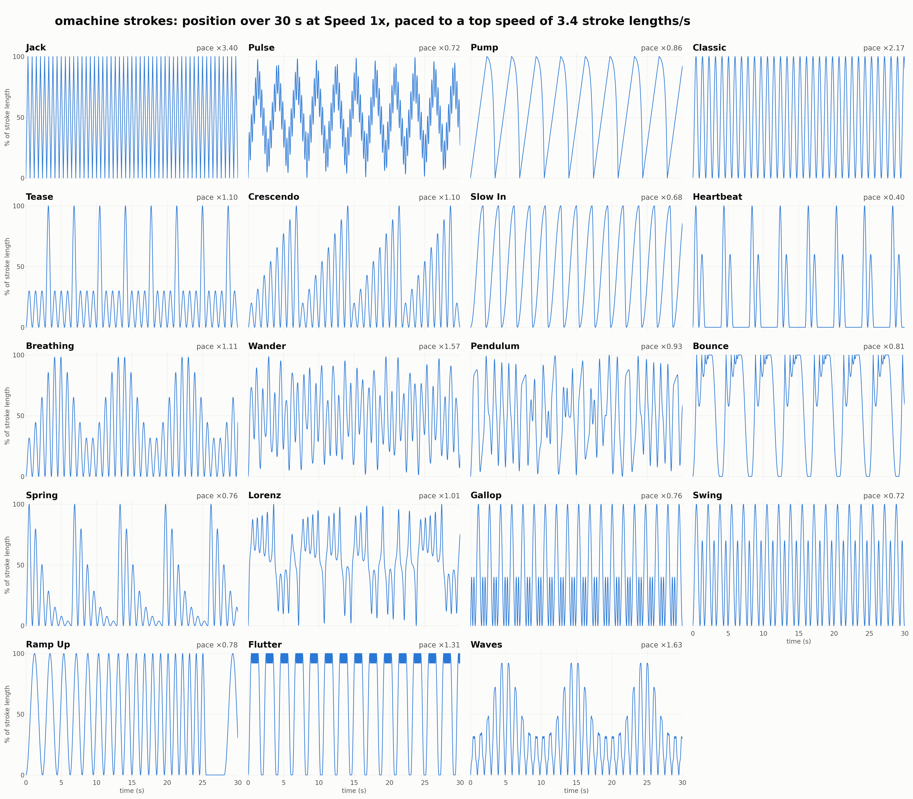

# omachine

The omachine is a linear-rail machine driven by an ODrive S1, controlled by a handheld haptic
handle. Move the handle and the carriage follows. You can also set it running one of 19 stroke
patterns, with the handle showing the speed, length and stroke on its round display. Both boards
are ESP32-S3s, linked wirelessly over ESP-NOW.

This repository has everything: the firmware for both boards, the handle's circuit boards
(KiCad) and the mechanical design (FreeCAD).



## What's here

```
controller/     firmware: the machine's controller (ESP32-S3 dev board, CAN to the ODrive S1)
manipulator/    firmware: the handle (ESP32-S3, DRV8311 gimbal motor driver, display, knob, button)
hardware/
  pcb/
    manipulator/       the handle's main board (KiCad 9)
    encoder-breakouts/ the handle's magnetic and rotary encoder boards (KiCad 9)
  cad/
    manipulator/       the handle (FreeCAD)
    machine/           the main machine (FreeCAD)
docs/           the stroke graph
```

## How it works

- **Start-up.** The controller brings the ODrive into closed loop. It then homes by driving the
  carriage slowly into each end of the rail, and sets the stroke's span just inside them. The
  handle finds its own end stops the same way.
- **Manual.** The carriage follows the handle, updated about 200 times a second. When the
  handle isn't being held, the carriage goes soft so it can be pushed by hand, and the handle's
  motor follows it; it stiffens again once the handle leads.
- **Auto.** The main button switches between Manual and the selected stroke. Pressing the knob
  steps through Speed, Length and Stroke, and turning it changes them. Holding the knob opens
  the menu, which sets Power (the motor's current limit), saves the settings as start-up
  defaults, sets up the ODrive and updates the firmware.
- **Faults.** If the ODrive stops, the handle shows why ("Supply voltage low", for example),
  what to check and the supply voltage. The controller retries a few times; after that, the
  main button retries.

## Getting started

The FreeCAD files are stored with [Git LFS](https://git-lfs.com/), so install it before cloning:

```
git lfs install
git clone https://github.com/mattedm/omachine.git
```

`controller/` and `manipulator/` are separate ESP-IDF (v6.1) projects. Build and flash each one
from its own folder (`idf.py build`, then `idf.py -p <port> flash`); see each project's README.
In VS Code, open `omachine.code-workspace` rather than the repository folder, so that
IntelliSense uses each project's own build settings.

The two boards talk using `omachine_protocol.h`. Each project has its own copy, and the two
must stay identical. Boards on different protocol versions ignore each other, so always update
both together.

## Firmware updates

After the first flash over USB, both boards update over the air from the handle's
**Update firmware** menu item. It downloads `manipulator.bin` and `controller.bin` from this
repository's latest release, installs its own, and passes the controller's image on over
ESP-NOW. To make a release, tag the repository (e.g. `v1.4`), run
`manipulator/tools/make_release.sh` with ESP-IDF activated, and attach both images to a GitHub
release (the script shows the `gh release create` line).

## The ODrive

The ODrive S1's configuration is in [`controller/odrive/`](controller/odrive). The handle's
**Set up ODrive** menu item writes it to the ODrive over CAN, calibrates the motor (including
anticogging) and saves it. Power 100% is 40 A and the top speed is 15 turns/s. Battery draw is
capped at 20 A, and the ODrive trips below 19 V; both are set for a 6S battery with a 25 A BMS.

## Changing the strokes

Each stroke is a function in [`controller/main/strokes.c`](controller/main/strokes.c). The top
of [`strokes.h`](controller/main/strokes.h) explains how to change one or add a new one. The
handle gets the stroke names from the controller, so only the controller changes.

## Hardware

See [`hardware/`](hardware) for the circuit boards (with the files to order them from JLCPCB)
and the FreeCAD models.

## License

Copyright 2026 MattEdm.

- **Firmware** (`controller/`, `manipulator/`): GPL-3.0-or-later. See [LICENSE](LICENSE). Some
  files carry their own notices; see each project's README.
- **Hardware** (`hardware/`): CERN-OHL-S-2.0. See [hardware/LICENSE](hardware/LICENSE).
